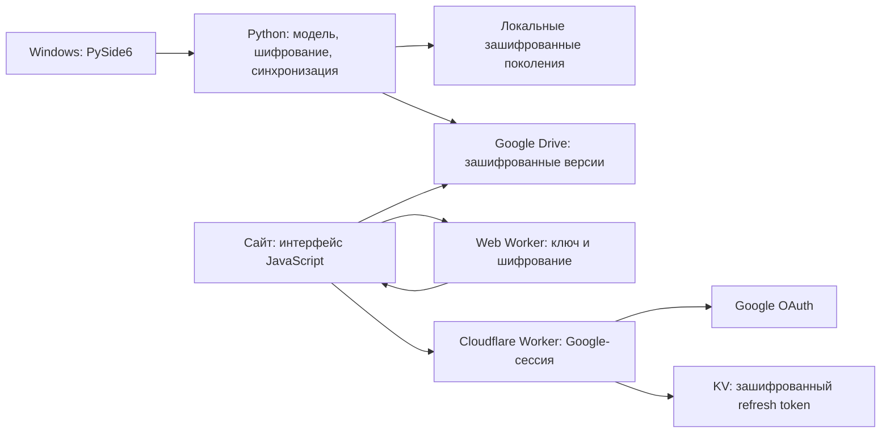

# Архитектура проекта Password Manager

Документ описывает устройство версии 0.39: Windows-приложение, сайт, Google Drive и серверную часть входа Google.

## Общая схема

Проект состоит из двух самостоятельных клиентов одного зашифрованного формата. Windows-клиент написан на Python и PySide6. Сайт написан на JavaScript и работает в браузере. Клиенты обмениваются зашифрованными версиями через Google Drive. Cloudflare Worker обслуживает сайт и Google-сессии веб-клиента.



Мастер-пароль нужен для открытия хранилища. Google-вход предоставляет доступ к файлам Drive. Эти два вида доступа независимы: подключённый аккаунт Google сам по себе не расшифровывает записи.

## Где что находится

| Каталог или файл | Назначение |
| --- | --- |
| [`src/password_manager/`](src/password_manager/) | Windows-приложение и Python-ядро |
| [`web/password-manager/dist/`](web/password-manager/dist/) | Готовые файлы сайта: HTML, CSS, JavaScript и локальные библиотеки |
| [`deployment/cloudflare-worker/`](deployment/cloudflare-worker/) | Серверные маршруты Google-сессий и конфигурация размещения сайта |
| [`deployment/cloudflare-pages/`](deployment/cloudflare-pages/) | Заголовки для статической поставки сайта |
| [`tests/`](tests/) | Python-тесты модели, хранения, интерфейса, шифрования, Drive и синхронизации |
| [`web/password-manager/tests/`](web/password-manager/tests/) | Node-тесты веб-ядра и совместимости с Python |
| [`web/password-manager/scripts/browser_qa.py`](web/password-manager/scripts/browser_qa.py) | Полные сценарии сайта в изолированном Chromium с вымышленными данными |
| [`scripts/`](scripts/) | Проверки, сборка EXE, упаковка, установщик и аудит поставки |
| [`docs/`](docs/) | Форматы, протоколы, инструкции и результаты проверок |
| [`docs/adr/`](docs/adr/) | Принятые архитектурные решения; старые документы нужно читать с учётом более поздних дополнений |
| [`PLAN.md`](PLAN.md), [`GLOSSARY.md`](GLOSSARY.md) | Требования и термины проекта |
| [`USER_GUIDE.md`](USER_GUIDE.md), [`CHANGELOG.md`](CHANGELOG.md) | Инструкция пользователя и история изменений |
| `artifacts/` | Локальные журналы, отчёты, хеши и проверочные снимки; не входят в Git |
| `build/` | Промежуточные файлы PyInstaller и сборки установщика |
| `dist/<version>/PasswordManager/` | Собранная Windows-программа с собственными зависимостями |
| `releases/<version>/` | Установщик, portable ZIP, локальный ZIP сайта и манифесты SHA-256 |

Веб-каталог `web/password-manager/dist` содержит поддерживаемые исходные файлы интерфейса. Здесь нет отдельного React-приложения или обязательного этапа транспиляции. Папка `dist` в корне проекта имеет другое назначение: это результат сборки Windows-программы.

## Windows: интерфейс и управление состоянием

| Модуль | За что отвечает |
| --- | --- |
| [`__main__.py`](src/password_manager/__main__.py), [`app.py`](src/password_manager/app.py) | Запуск Qt, главное окно, экран блокировки, редактор записей, настройки, закрытие в трей, таймер бездействия и события Windows |
| [`session.py`](src/password_manager/session.py) | Открытая сессия: доступ к ключу, текущий документ, новый UUID актора и сохранение изменений через `mutate` |
| [`model.py`](src/password_manager/model.py) | Проверка документа, записи, категории, иерархия, корзина, поиск, постоянные метки окончательного удаления |
| [`category_list.py`](src/password_manager/category_list.py) | Перетаскивание категорий, сворачивание веток и управление стрелками |
| [`theme.py`](src/password_manager/theme.py), [`icons.py`](src/password_manager/icons.py) | Qt-стили, значки и буквы в значках записей; исходные ресурсы находятся в `assets/` |
| [`preferences.py`](src/password_manager/preferences.py) | Незашифрованные служебные предпочтения: режим окна, действие закрытия, UUID последнего открытого хранилища |
| [`paths.py`](src/password_manager/paths.py) | Выбор каталога данных установленной и переносимой программы |
| [`generator.py`](src/password_manager/generator.py) | Локальная генерация паролей; результат становится записью только после сохранения |
| [`importer.py`](src/password_manager/importer.py) | Проверка и предварительный просмотр старого JSON-формата |
| [`updates.py`](src/password_manager/updates.py) | Проверка метаданных GitHub Releases и предложение открыть страницу обновления; установки в фоне нет |
| [`errors.py`](src/password_manager/errors.py) | Безопасные сообщения об ошибках без содержимого записей и секретов |

`app.py` связывает элементы интерфейса с ядром. Правила работы с данными находятся в модели, а операции записи на диск — в `Store`. Это позволяет проверять большую часть поведения без настоящего рабочего стола.

## Шифрование и локальное хранение

[`crypto.py`](src/password_manager/crypto.py) реализует конверт PMVAULT. Случайный 256-битный ключ данных шифрует содержимое через AES-256-GCM. Ключ, полученный из мастер-пароля через Argon2id, защищает ключ данных. Ключ восстановления защищает его отдельной обёрткой.

Текущие параметры Argon2id: память 65 536 КиБ, 3 прохода, параллелизм 4. Заголовок аутентифицируется вместе с шифротекстом. JSON читается с проверкой структуры, ограничений и повторяющихся ключей. Подробности: [формат PMVAULT](docs/vault-format.md).

[`storage.py`](src/password_manager/storage.py) хранит поколения зашифрованных состояний. Новое поколение сначала целиком записывается в отдельную папку, после чего атомарно заменяется указатель `CURRENT`. Сохраняется актуальное состояние и до семи предыдущих. Служебная запись очереди синхронизации может заменить текущее состояние, сохраняя содержательную историю.

```text
PersonalPasswordManager/
  CURRENT                         указатель на актуальное поколение
  <UUID поколения>/
    0.pmvault                     актуальное состояние
    1.pmvault ... 7.pmvault        предыдущие состояния
  session.lock                    блокировка одновременного доступа
  preferences.json                режим окна, закрытие, последний UUID
  google-connection.dpapi          подключение Google, защищённое Windows DPAPI
  switched-vaults/<UUID>/          архив прежнего хранилища при переключении
  sync-blocked/                   сохранённые копии при несовместимом доступе
```

Установленная программа использует `%LOCALAPPDATA%\PersonalPasswordManager`. Portable-сборка с `portable.flag` хранит данные в `data` рядом с EXE. Данные отделены от каталога установленной программы.

При переключении на другую облачную копию `Store.switch_to_copy` сначала копирует все прежние зашифрованные состояния в `switched-vaults` и проверяет точное совпадение байтов. Только затем публикуется новое рабочее поколение. Ошибка до публикации сохраняет прежний `CURRENT`. Архив расшифровывается прежним мастер-паролем.

## Синхронизация: общая логика двух клиентов

| Python | JavaScript | Роль |
| --- | --- | --- |
| [`sync_state.py`](src/password_manager/sync_state.py) | [`sync.js`](web/password-manager/dist/sync.js), часть [`core.js`](web/password-manager/dist/core.js) | Причинные регистры, слияние, проекция в документ и конфликты |
| [`sync.py`](src/password_manager/sync.py) | [`sync.js`](web/password-manager/dist/sync.js) | Подготовка версии, сохранённая очередь, подтверждение точных байтов, наблюдённые версии |
| [`drive.py`](src/password_manager/drive.py) | [`drive.js`](web/password-manager/dist/drive.js) | Список и чтение файлов Drive, публикация и проверка обратным чтением |
| [`sync_ui.py`](src/password_manager/sync_ui.py) | [`app.js`](web/password-manager/dist/app.js) | Запуск обмена, состояние подключения, ручная/периодическая синхронизация, отображение результатов |

Каждая запись, название категории, её родитель и цвет представлены регистрами `entry:<uuid>`, `category:<uuid>`, `category_parent:<uuid>`, `category_color:<uuid>`. Вектор наблюдений позволяет отличить более новое изменение от независимого параллельного изменения. Время сохранения используется для списка резервных копий; конфликт паролей или записей по времени не разрешается.

Несовместимые параллельные изменения сохраняются до явного выбора. Изменения разных регистров объединяются автоматически. Постоянные метки удаления препятствуют восстановлению старых удалённых записей из давно не подключавшегося клиента. У цвета значение null означает сброс, а не отсутствие истории.

Облачная версия содержит зашифрованный payload `protocol`, `id`, `state`. Локальные тема, автоблокировка и черновики в него не входят. Цвета категорий передаются отдельными регистрами. Полные резервные состояния и экспорты содержат документ целиком.

Перед отправкой сохраняются точные байты версии и её UUID. После сетевого сбоя повторяется та же версия. Публикация подтверждается после чтения и сравнения байтов. Содержимое хранилища расшифровывается на клиенте. Полный протокол и ограничения описаны в [sync-protocol.md](docs/sync-protocol.md).

В Windows сетевые операции идут в `IOThread`/`QThread`. Поток получает зашифрованные байты и доступ к подключению Google; ключ хранилища в сетевую операцию не передаётся. Разбор расшифрованного документа и фиксация результата выполняются в Qt-потоке. При блокировке отменяется применение результата старой операции.

## Просмотр резервных копий и последнее открытое хранилище

[`cloud_backups.py`](src/password_manager/cloud_backups.py) и [`cloud-backups.js`](web/password-manager/dist/cloud-backups.js) задают одинаковый порядок: `modifiedTime`, затем `createdTime`, затем время из имени резервного файла. Копии без известного времени идут внизу. Тип файла не даёт приоритета над более свежей копией.

Самая свежая доступная копия последнего открытого хранилища вынесена в выделенный блок «Последнее открытое хранилище». Остальные копии идут ниже от новых к старым; закреплённая копия в общем списке не дублируется. Сопоставление выполняется по UUID хранилища.

Сайт хранит только этот UUID в `localStorage` под ключом `pm-last-opened-vault`. Маркер обновляется после успешной разблокировки или создания хранилища и переживает перезагрузку. В Windows тот же смысл имеет поле `last_opened_vault` в `preferences.json`.

[`cloud_browser.py`](src/password_manager/cloud_browser.py) содержит нативный список и просмотр выбранной копии. Доступны просмотр записей со скрытым паролем, экспорт обычного `.pmvault` и переключение рабочего хранилища. Для открытия требуется мастер-пароль выбранной копии. Архив прежнего хранилища доступен отдельным действием в приложении.

## Устройство сайта

| Файл в `web/password-manager/dist/` | Назначение |
| --- | --- |
| `index.html`, `style.css`, `local-fonts.css` | Оболочка страницы, адаптивная разметка и оформление |
| `app.js` | Экран создания/разблокировки, список, редактор, модальные окна, действия пользователя и координация Worker/Drive |
| `vault-worker.js` | Web Worker: открытые ключи и криптографические операции, подготовка изменений до подтверждения |
| `core.js` | Формат, проверка данных, AES-GCM, Argon2id через локальную библиотеку, генерация паролей и отслеживание изменений |
| `sync.js`, `drive.js`, `sync-schedule.js` | Слияние версий, HTTP к Drive, таймер обмена |
| `google.js`, `oauth-config.js` | Google-вход, обновление access token и публичный Web Client ID |
| `storage.js` | Рабочие зашифрованные состояния вкладки в памяти `Map`; новые хранилища не записываются в IndexedDB |
| `legacy.js` | Обнаружение прежних хранилищ IndexedDB с возможностью экспорта/удаления |
| `categories.js`, `vault-names.js`, `cloud-backups.js` | Иерархия, имена файлов, сортировка копий и сохранённый UUID последнего открытия |
| `vendor/hash-wasm.js` | Локальная библиотека для Argon2id; её лицензия хранится рядом |

Интерфейс обращается к Web Worker сообщениями RPC. Обновление сначала подготавливается как отдельная стадия. После успешного сохранения зашифрованного снимка стадия подтверждается; при ошибке отбрасывается. Доступ к выбранному файлу, когда браузер его предоставляет, используется для записи на ПК. Без файлового доступа актуальную копию нужно экспортировать или синхронизировать в Drive.

После перезагрузки вкладки рабочий `Map` и открытый ключ исчезают. Маркер последнего открытия и серверная Google-сессия помогают снова выбрать нужную копию; для её расшифровки требуется мастер-пароль. Сам маркер не сохраняет содержимое хранилища.

## Google OAuth и Cloudflare

Windows использует [`oauth.py`](src/password_manager/oauth.py): системный браузер, PKCE-S256, проверку state и локальный loopback callback. [`protected.py`](src/password_manager/protected.py) сохраняет подключение Google через Windows DPAPI. [`http_client.py`](src/password_manager/http_client.py) задаёт ограниченные HTTP-запросы, тайм-ауты и отмену.

Сайт использует отдельный Web OAuth-клиент. [`deployment/cloudflare-worker/session.mjs`](deployment/cloudflare-worker/session.mjs) обменивает код Google и хранит refresh token в KV, зашифрованный ключом сервера. Браузер получает HttpOnly/Secure/SameSite cookie с идентификатором сессии и краткоживущий access token для прямых запросов Drive. Refresh token не выдаётся клиентскому JavaScript. Сессия рассчитана на 30 дней.

Маршруты Worker: `/api/google/config`, `/api/google/exchange`, `/api/google/token`, `/api/google/logout`. Остальные запросы идут к статическим файлам сайта через binding `ASSETS`. Настройки размещения находятся в [`wrangler.jsonc`](deployment/cloudflare-worker/wrangler.jsonc); секреты `GOOGLE_CLIENT_SECRET` и `SESSION_ENCRYPTION_KEY` хранятся в Cloudflare Secrets.

Worker не получает мастер-пароль, ключ данных и расшифрованные записи. Google Drive хранит зашифрованные файлы; их имена, время и служебные метаданные доступны как обычные метаданные Drive.

## Сборка, поставка и проверки

1. [`scripts/verify.py`](scripts/verify.py) запускает Python-тесты, проверяет зависимости и ссылки, сохраняет хеши исходников и отчёты.
2. `npm test` в `web/password-manager` проверяет веб-ядро, Drive и совместимость Python/JavaScript. `browser_qa.py` проверяет интерфейс в изолированном Chromium.
3. [`scripts/build.py`](scripts/build.py) собирает PyInstaller-каталог программы и сохраняет необходимое замыкание Qt DLL, включая QtSvg.
4. [`scripts/check_bundle.py`](scripts/check_bundle.py) запускает собственный тест собранного EXE с фиктивным хранилищем. Проверяется работа без зависимостей из среды разработки.
5. [`scripts/package_windows.py`](scripts/package_windows.py) создаёт portable ZIP и установщик. [`scripts/Setup.cs`](scripts/Setup.cs) реализует установку/удаление для текущего пользователя.
6. [`scripts/package_web.py`](scripts/package_web.py) создаёт отдельный локальный ZIP сайта. Server-side Google-сессии размещаются через Worker, а не одним статическим ZIP.
7. [`scripts/audit_release.py`](scripts/audit_release.py) сверяет сборку, архивы, ресурсы значков и манифесты; [`scripts/audit_public_source.py`](scripts/audit_public_source.py) проверяет публикуемый Git-снимок.

В GitHub Releases публикуются установщик `PasswordsManager.exe` и portable ZIP Windows. ZIP сайта остаётся локальным. Сайт развёртывается отдельно через Wrangler. Исторические скрипты с номерами старых версий сохранены для воспроизводимости; текущие команды — перечисленные выше.

Автотесты на вымышленных данных, имитация Drive, работа упакованного EXE, фактическая публикация, ручной Google-вход и работа нескольких реальных устройств — разные уровни проверки. Актуальные результаты конкретного выпуска находятся в его `docs/verification-<version>.md` и локальных отчётах `artifacts/`.

## С чего начинать изменение

- Правило записи, категории или корзины: `model.py`; соответствующая веб-логика — `core.js`, `categories.js`, `app.js`.
- Формат, шифрование или восстановление доступа: `crypto.py` и `core.js`, затем межъязыковые тесты.
- Запись на диск, архивирование или экспорт: `storage.py`; файловые действия сайта — `app.js` и `storage.js`.
- Причинная синхронизация: `sync_state.py`/`sync.py` и `core.js`/`sync.js`; изменение нужно проверять с обеих сторон.
- Список облачных копий: `drive.py`/`drive.js`, `cloud_backups.py`/`cloud-backups.js`, `cloud_browser.py`/`app.js`.
- Окно и Windows-поведение: `app.py`, `preferences.py`, `theme.py`.
- Google-подключение: `oauth.py`/`protected.py` для Windows, `google.js`/`session.mjs` для сайта.
